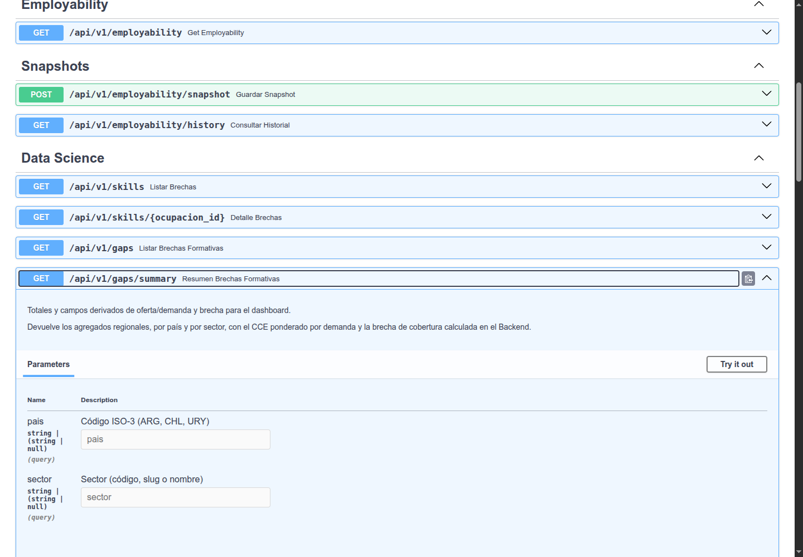
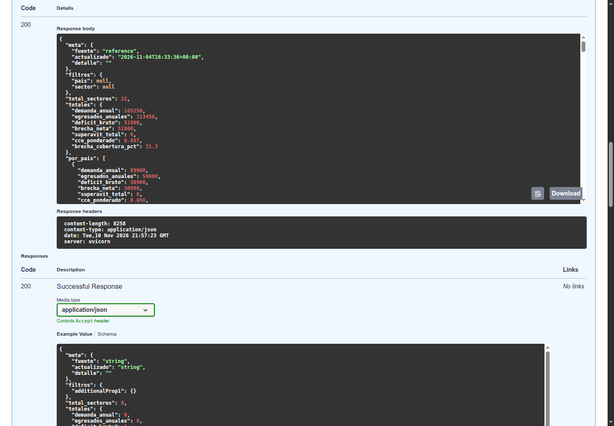
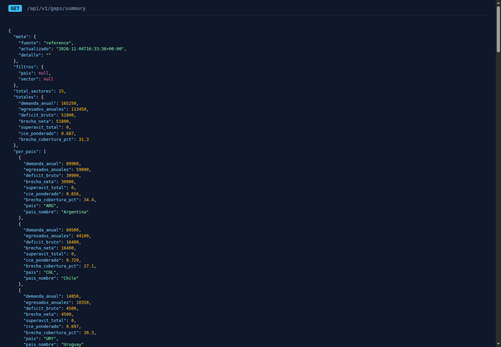
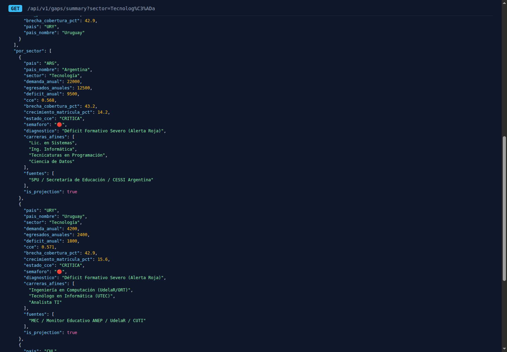
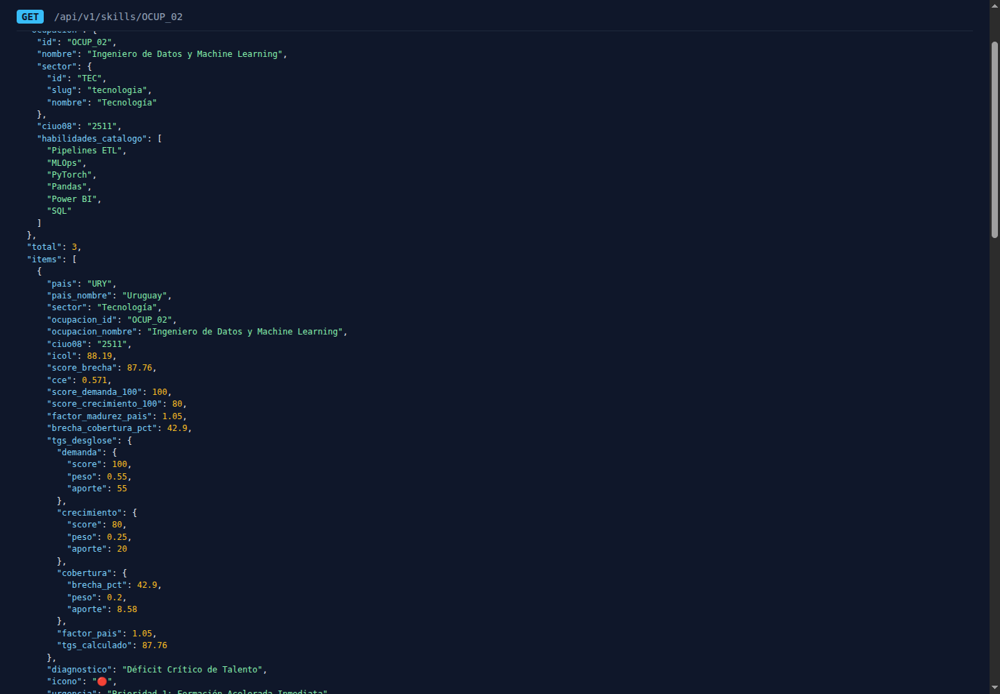
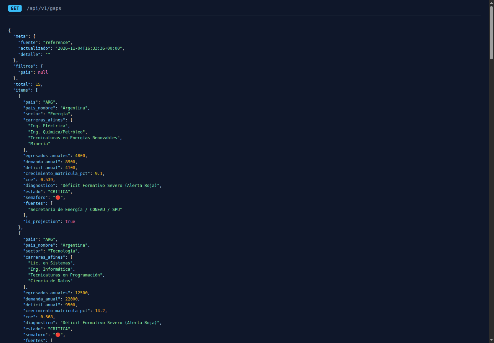

# Cambios del backend — Noviembre 2026

Este documento resume los cambios más importantes del módulo de brechas y
oferta/demanda, con capturas tomadas desde el navegador sobre el backend
corriendo en local.

> **Nota:** las respuestas se generaron con el snapshot de referencia
> (`data/reference/`), por eso `meta.fuente` es `reference`. En producción,
> cuando la API de Data está disponible, el mismo contrato devuelve
> `meta.fuente: "live"`.

## Índice

1. [Nuevo endpoint `/api/v1/gaps/summary`](#1-nuevo-endpoint-apiv1gapssummary)
2. [Respuesta del resumen regional](#2-respuesta-del-resumen-regional)
3. [Filtro por sector](#3-filtro-por-sector)
4. [Desglose del Talent Gap Score en `/skills`](#4-desglose-del-talent-gap-score-en-skills)
5. [Crecimiento de matrícula en `/gaps`](#5-crecimiento-de-matrícula-en-gaps)
6. [PRs incluidos](#6-prs-incluidos)

---

## 1. Nuevo endpoint `/api/v1/gaps/summary`

El endpoint aparece publicado en Swagger junto al resto del módulo de
Data Science. Devuelve los agregados de oferta, demanda y brecha para el
dashboard, sin que el Frontend tenga que recalcular fórmulas.



**Qué mirar:** parámetros `pais` y `sector`, ambos opcionales, y la
descripción del cálculo del CCE ponderado.

---

## 2. Respuesta del resumen regional

La respuesta incluye `totales`, `por_pais` y `por_sector`. El CCE agregado
se pondera por demanda (`Σ egresados / Σ demanda`), no es un promedio simple.



Vista directa del JSON en el navegador:



**Qué mirar:** `deficit_bruto`, `brecha_neta`, `cce_ponderado` y
`brecha_cobertura_pct`. Para la región: déficit de **51.800** puestos y
cobertura del **68,7 %**.

---

## 3. Filtro por sector

El endpoint acepta código, slug o nombre del sector. En el ejemplo se filtra
`Tecnología` y se obtienen las tres filas país × sector.



**Qué mirar:** `filtros.sector`, `total_sectores` y el semáforo de cada fila.

---

## 4. Desglose del Talent Gap Score en `/skills`

`/skills` ahora explica el score de brecha: cuánto aporta la demanda
(55 %), el crecimiento (25 %) y la falta de cobertura educativa (20 %),
ajustado por el factor de madurez del país.



**Qué mirar:** `score_demanda_100`, `score_crecimiento_100`,
`brecha_cobertura_pct` y `tgs_desglose`. Para URY / OCUP_02, el TGS es
**87,76** y se reconstruye con los tres componentes.

---

## 5. Crecimiento de matrícula en `/gaps`

Antes el campo `crecimiento_matricula_pct` llegaba `null` porque el mapper
no podía convertir textos como `"+14.2% anual"`. Ahora se parsea y se expone
como número.



**Qué mirar:** `crecimiento_matricula_pct` en cada sector (`9.1`, `14.2`,
etc.) y el resto de los campos de oferta/demanda.

---

## 6. PRs incluidos

| PR | Cambio |
|---|---|
| [#9](https://github.com/InnovaLab-2C-2026-Equipo-6/app-backend/pull/9) | Núcleo metodológico de brechas y TGS |
| [#10](https://github.com/InnovaLab-2C-2026-Equipo-6/app-backend/pull/10) | Fix de `crecimiento_matricula_pct` |
| [#11](https://github.com/InnovaLab-2C-2026-Equipo-6/app-backend/pull/11) | Desglose del TGS en `/skills` |
| [#12](https://github.com/InnovaLab-2C-2026-Equipo-6/app-backend/pull/12) | Nuevo `/api/v1/gaps/summary` |
| [#13](https://github.com/InnovaLab-2C-2026-Equipo-6/app-backend/pull/13) | Contrato, mock y tests de paridad |
| [#14](https://github.com/InnovaLab-2C-2026-Equipo-6/app-backend/pull/14) | Documentación del README y del contrato |

---

## Cómo reproducir las capturas

```bash
# 1) Levantar el backend
./venv/bin/python -m uvicorn app.main:app --port 8000

# 2) Abrir Swagger
# http://127.0.0.1:8000/docs

# 3) Abrir los endpoints
# http://127.0.0.1:8000/api/v1/gaps/summary
# http://127.0.0.1:8000/api/v1/gaps/summary?sector=Tecnología
# http://127.0.0.1:8000/api/v1/skills/OCUP_02
# http://127.0.0.1:8000/api/v1/gaps
```

El ejemplo completo del contrato está en
[`docs/mocks/gaps_summary.json`](mocks/gaps_summary.json) y las fórmulas en
[`docs/Data_Contracts.md`](Data_Contracts.md) §4.5.
